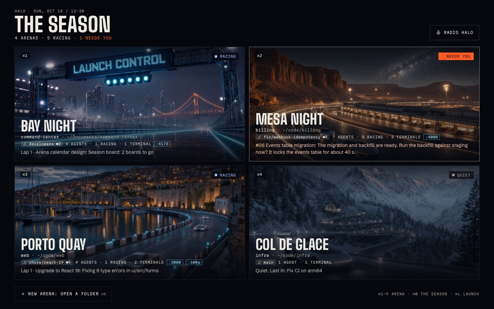
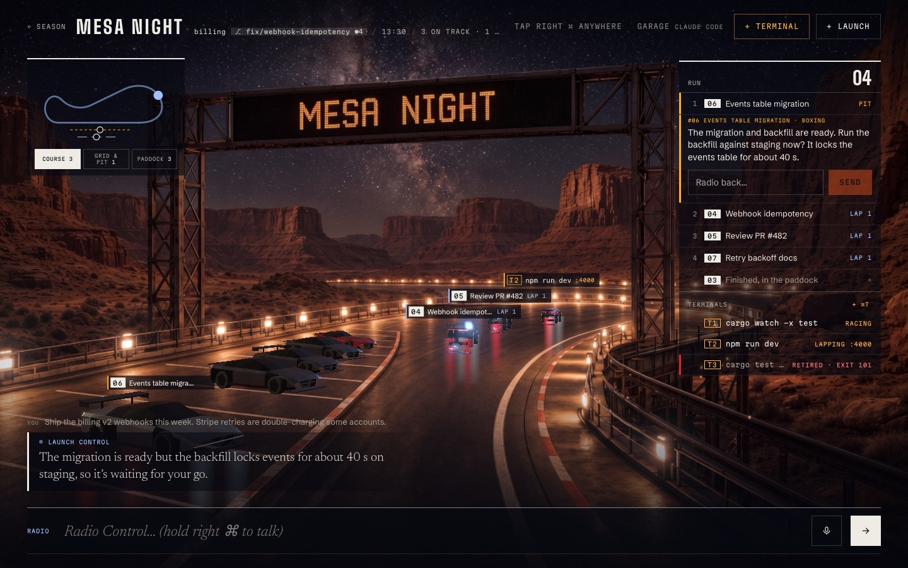
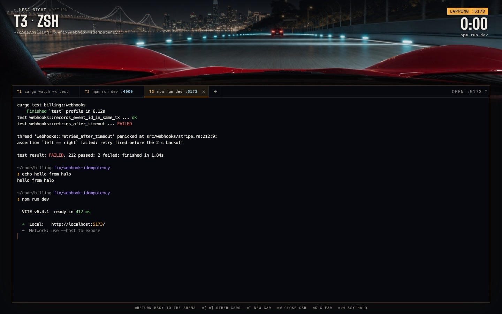
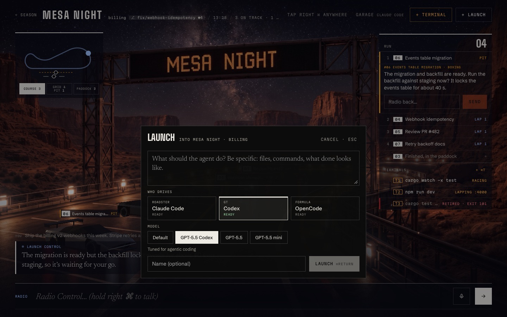
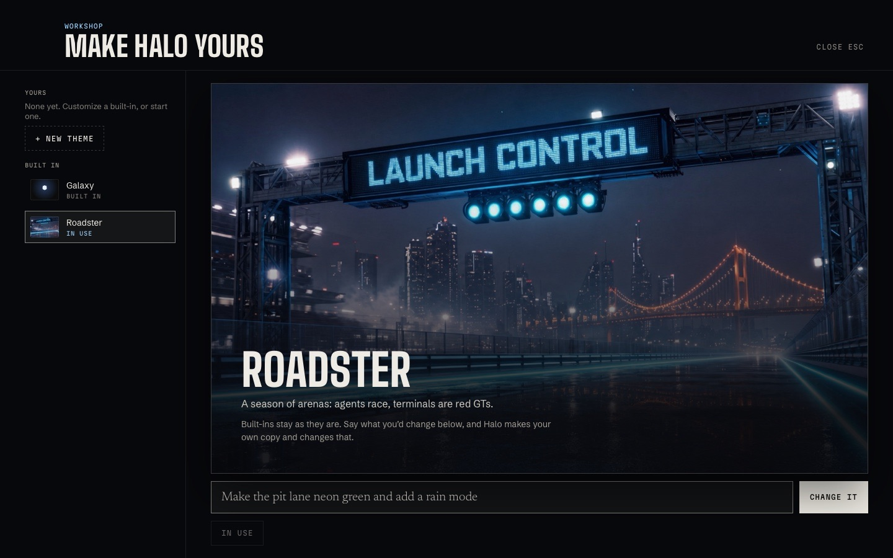

# Halo

**One thread for everything you're building.** Talk to Halo from any app; it
answers fast and hands anything long to **agents** (your own Claude Code,
Codex or OpenCode) that work in your repositories side by side, in the
background. You watch them race, answer them when they ask, drive them, or
open a real terminal, without ever waiting on one.



| An arena: agents race, terminals are red GTs | Onboard a terminal car: a real shell |
|---|---|
|  |  |
| **Launch an agent: who drives, on which model** | **The Workshop: make Halo yours by asking** |
|  |  |

## What it does

- **A thread that never blocks.** Ask anything. Quick things Halo answers;
  long things become an agent and Halo tells you when it's done, when it needs
  you, or when it goes quiet. Summon it with a tap of right ⌘ from any app.
- **Workspaces are arenas.** Open your repositories; each becomes a circuit of
  its own (Bay Night, Mesa Night, Porto Quay, Col de Glace). Agents launched in
  one work in that checkout; Halo always knows which one you're in.
- **Agents are cars.** Claude Code is a roadster that launches off a ramp with
  a flip; Codex a GT; OpenCode a formula car. Their lap is their progress; the
  pit is where they wait for you. Hover one and drive it; the race goes on.
- **Terminals are red GTs.** Real shells (your own zsh or bash and config) in
  each workspace. Idle ones park; a running command races; a dev server laps
  with its port on the car; a failed command spins off. Go onboard and the
  dashboard is the terminal. Ask Halo why something failed: it reads the output.
- **Talk to it.** Hold the key and speak; dictation and transcription run on
  your machine.
- **Make it yours.** The Workshop: say what you want changed ("make the pit
  lane neon green", "make me an underwater theme where agents are submarines")
  and an agent rewrites the theme while you watch it rebuild. Themes are web
  code (React, three.js) built against a kit; they run sandboxed and offline,
  and may do only what their manifest allows. Every change can be undone.
- **Updates itself.** Signed, verified updates, installed in place.

## Status

macOS 13+ (Apple silicon or Intel). Windows is in progress.

## Build from source

You need macOS, [Rust](https://rustup.rs) 1.88+, Node 22, the Tauri CLI
(`cargo install tauri-cli --version "^2"`), and at least one agent CLI signed
in: [Claude Code](https://claude.com/claude-code), Codex or OpenCode.

```sh
git clone https://github.com/constructionlive/projecthalo.git && cd projecthalo
(cd ui && npm ci)
scripts/stage-kit.sh                                  # the theme kit (esbuild, libraries)
cd crates/halo-app && cargo tauri dev                 # run it, with live UI reload
cd crates/halo-app && cargo tauri build --debug       # or an app: target/debug/bundle/macos/Halo.app
```

The UI also runs in a plain browser as a scripted demo, for design work:
`cd ui && npx vite` and open http://localhost:5173.

**The summon key** (a tap of right ⌘; ⌘⇧Space always works) needs System
Settings → Privacy & Security → Input Monitoring → Halo. macOS ties that
permission to the app's signature, and an unsigned build gets a new one on
every build; sign your builds with your own identity to keep it:

```sh
cd crates/halo-app && APPLE_SIGNING_IDENTITY="Apple Development: <you> (<team>)" cargo tauri build --debug
```

## How it's built

| | |
|---|---|
| `crates/halo-core` | The engine: `Halo` (the main thread), agents (`stars.rs`: sessions, inboxes, heartbeat, stalls), `workspaces`, `terminals` (PTYs with shell integration), `themes` (build, watch, history), the tools Halo's own model uses, and the store with its append-only event log. |
| `crates/halo-app` | The Tauri app: windows, the summon key, voice, updates, the `halotheme://` protocol, and the commands the UI calls. |
| `crates/cc-agent` | How a turn runs on Claude Code, Codex or OpenCode (the CLI, with Halo's tools served over MCP), or on any OpenAI-compatible endpoint. |
| `crates/voice-core` | On-device speech: audio capture, voice activity, speech-to-text. |
| `ui/` | The window (React, three.js). `sky/Host.tsx` owns it; `sky/Sky.tsx` is the Galaxy theme, `roadster/` the Roadster world, `kit/` what custom themes are built with. |

Try one turn without the UI:

```sh
cargo build -p halo-app && CC_BRIDGE_EXE=$PWD/target/debug/halo \
  cargo run -p cc-agent --example turn -- claude "What's in this folder?"
```

## Themes

Every world in Halo is a theme, and anyone can make one, in the app by asking
or by hand. [`ui/src/kit/KIT.md`](ui/src/kit/KIT.md) explains what a theme is
given, what it may do, and how it's built. Built-in themes are welcome as pull
requests.

## Tests

```sh
cargo test -p halo-core -p cc-agent          # the engine (real shells, real builds, scripted agents)
node e2e/run.mjs                            # the real app on your Claude Code (see e2e/README.md)
node e2e/scene.mjs                          # the Roadster world in WebKit
e2e/update.sh                               # a real update, end to end
```

## Contributing

See [CONTRIBUTING.md](CONTRIBUTING.md). Issues and pull requests are welcome.

## License

[MIT](LICENSE). The speech engine comes from LiveType. The photographic
plates and concept art were generated for Halo.
